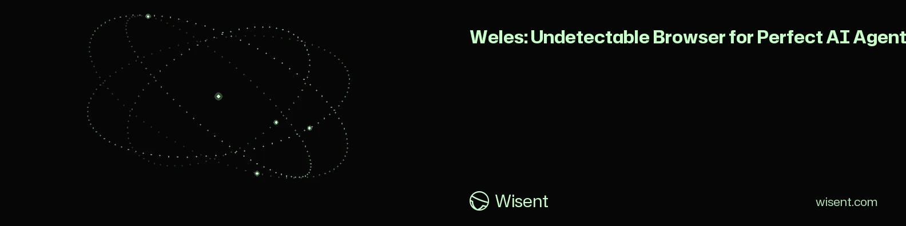
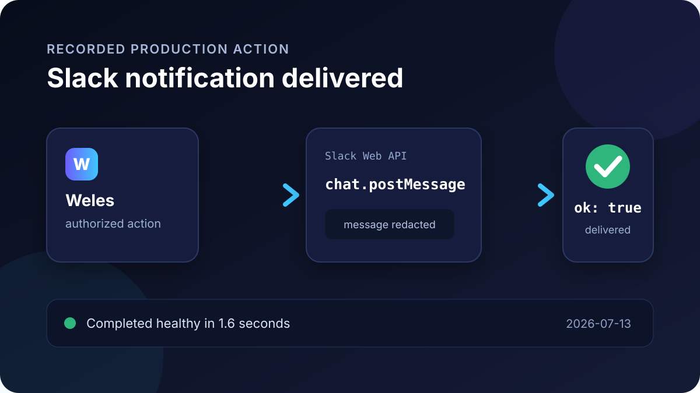
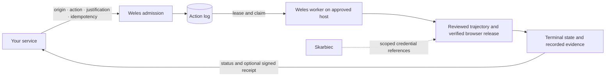

<!-- wisent-banner:start -->
<p align="center">
  
</p>
<!-- wisent-banner:end -->

<!-- wisent-readme-signals:start -->
[](https://github.com/wisent-ai/weles) [](https://github.com/wisent-ai/weles/issues) [](https://wisent.com) [](https://discord.gg/qRjpkthq54) [](https://www.linkedin.com/company/wisent-ai/) [](https://x.com/wisentai) [](https://calendly.com/lbartoszcze)
<!-- wisent-readme-signals:end -->

# Weles: Undetectable Browser for Perfect AI Agent Internet Use

Your AI agents deserve to explore the entire internet. AI can now write
software, reason for hours, and order your groceries, but it still fails or
takes ages when you ask it to open a website and log in to your account.

Weles is the solution. We turn the open internet into an API.

Weles is an undetectable browser that combines custom C++-patched Chromium and
Firefox forks with rotating fingerprints to stop your AI from running into
CAPTCHAs and bans. Every time you crawl a website, it gets mapped into a
trajectory, allowing future runs to use the cached traversal instead of having
to rediscover how the website works. When a run fails, Weles records videos
showing the points of failure to give you a clear understanding of what happened
and how it can be fixed.

Read Google 2FA without changing it: the operator CLI and Desktop reach the Stado-managed executor at the route `stado service directory connect weles-admission --consumer operator` gives, with the token of the item playing the worker's API role (`stado credentials get --role echo-weles-api --field token`); `WELES_WORKER_API_BASE` and `WELES_WORKER_TOKEN` override both. Then use `weles security --provider google --login-role <skarbiec-role>` and `weles security --run <run-id>`. The provider is named, as for `login` and `certificate`; google is the one Weles reads, and a start without it is refused (`security needs --provider naming the identity provider whose account it reads; Weles reads google`, exit 2). This uses detached `/run` execution and retained diagnostics, not the removed database queue. The [account-security reference](https://weles.wisent.com/docs/account-security) distinguishes a provider-confirmed boolean from an unknown state; a saved seed proves neither.

Connect Gmail through the managed executor with `weles password --provider google --login-role <skarbiec-role> --organization <skrzynka-organization> --account <mailbox-email>` or `weles password --provider google --login-item <skarbiec-item> --organization <skrzynka-organization> --account <mailbox-email>`, then read its result with `weles password --run <run-id>`. Provider, organization and expected mailbox account must be explicit. Admission records these alongside the exact Skarbiec login; the executor compares the resolved login with the expected account before opening the browser. A changed or incorrectly selected login must not connect a different mailbox. An existing login does not need a role tag when its item is named directly. Skrzynka accepts the generated password only after a real IMAP login; accepting a run is not proof that the mailbox connected. See the [documentation](https://weles.wisent.com/docs/reference/security/app-password).

[Documentation](https://weles.wisent.com/docs) · [Releases](https://github.com/wisent-ai/weles/releases) · [MIT licence](LICENSE)

## See Weles work

These are public, redacted cuts from production runs. Dark boxes cover credentials
and account identifiers; the browser interaction is otherwise unchanged.

Weles opens GitHub and reaches the authenticated dashboard:


The Reddit cut ends at the enabled Log In button; the production action completed
healthy and a later health action confirmed the stored session remained usable:


Weles reaches LinkedIn's authenticated home feed; the public cut hides the profile:


Slack delivery uses `chat.postMessage`, not a browser, so there is no screen
recording. The production action received `ok: true` and completed in 1.6 seconds:



## Request access

Weles is an operated service. Access starts through
[weles.wisent.com/docs](https://weles.wisent.com/docs#get-access) or by
[booking a call](https://calendly.com/lbartoszcze). An approved deployment
provides its endpoint, organization identifier, and organization-scoped token:

```sh
export WELES_API_BASE=<deployment-endpoint>
export WISENT_ORGANIZATION_ID=<organization-uuid>
export WELES_TOKEN=<organization-scoped-token>
```

Both Weles and [weles-client](https://github.com/wisent-ai/weles-client) are public,
MIT-licensed source. You can inspect, build, and operate your own deployment.
A checkout does not include a hosted endpoint, approved trajectories, managed
credentials, evidence retention, or an SLA; these are provisioned per organization.

## Import existing Weles workflows

First setup can adopt the JSON returned by `GET /api/v1/trajectories`:

```sh
weles onboarding next
weles onboarding import <trajectory-export.json> --host <managed-worker-hostname>
```

`weles onboarding next` answers the current first-use screen with
`control_plane` (`connected` or `offline`) and `journey_source`, where the
journey definition came from: `control_plane`, `stored` (this device's copy)
or `bundled` (the definition shipped with Weles). When the run did not use the
control plane's current state, `degraded` lists each step it fell back, with
its cause: why the control plane's journey could not be read or was invalid,
why it was not stored for offline use, why the stored copy was invalid, a
resumed attempt that could not be reconciled with central state, or an event
that stays queued (`undelivered_events` names the first refusal; the next run
sends queued events again).

The reusable command outside onboarding is:

```sh
weles import <trajectory-export.json> --host <managed-worker-hostname>
```

Both call `POST /api/v1/imports` using `WELES_API_BASE`, `WISENT_ORGANIZATION_ID`,
and `WELES_TOKEN`. Import validates the entire export before writing, requires
its tenant to match the authenticated organization, preserves existing rows,
and reports `imported`, `unchanged`, or `refused` for each source trajectory.
Accepted definitions are stored as drafts with their source identity, digest,
and exact target hostname. A draft is not authorization to execute.

The local HTTP service exposes authenticated `POST /imports` around that same
operation. It always requires `WELES_API_TOKEN`; the destination uses `WELES_TOKEN`.
Imports accept browser, OS, locale, headless, proxy, and session-label configuration,
but never scan or copy profiles, cookies, or credentials. A session label refers
only to state already present on the selected host.

Agents submit authorized workflows through
[`@wisent-ai/weles-client`](https://weles.wisent.com/docs/client), naming the exact
origin, action, non-secret input, credential references, justification, and
idempotency key. An accepted production action resolves to a reviewed trajectory
and ends in an explicit action-log state. When receipt issuance is configured,
the client verifies the signed outcome and evidence digest offline.

## Worker identity diagnostics

`weles worker status --json` retains `serviceIdentityFailure.operation` and
`serviceIdentityFailure.message` when the deployed identity was refused, and
`browserRuntime`, the last finished probe of the browser runtime in the shape
`weles doctor` prints, with `probingSince` while a probe still runs.
The same fields appear in text output and Weles Desktop's **System → Worker**.
They describe the last identity read and the last finished probe, not a new
one; a later successful identity read clears the failure. A running process
alone is not readiness. The public version endpoint keeps its generic refusal
without private details.

The real read-only qualification is
`WELES_BIN=/absolute/path/to/weles WELES_TEST_IDENTITY_STATE=refused WELES_TEST_RUNTIME_STATE=reported node tests/worker/identity-diagnostics.mjs`;
repeat with `ready` against a deployment whose identity Stado has restored, and
with `WELES_TEST_RUNTIME_STATE=probing` while a runtime probe runs. A missing
or unknown input is refused by name and kept in the run's `report.json`.
It requires a committed checkout and the matching deployed source revision.
See [resident worker controls](https://weles.wisent.com/docs/concept-scheduler#resident-worker-controls)
for the failed operations, evidence location and verification limits.

## Enterprise

Weles Enterprise makes browser work a reviewed production capability. An
engagement defines origins and actions, versions approved trajectories, provisions
client and worker access, and binds credentials and evidence to the organization.
It can include deployment-ring policy, credential lifecycle integration, evidence
retention, and operating support. It grants no blanket permission to automate a
website; the source remains public. [Book a call](https://calendly.com/lbartoszcze).

## What your agents can do

- Browse through custom Chromium and Firefox builds with rotating fingerprints.
- Replay approved trajectories instead of rediscovering every workflow.
- Diagnose failures from the recorded operation, browser state and evidence.
- Verify terminal outcomes and, when configured, signed execution receipts.
- Use the Skarbiec credential lifecycle: acquire, adopt, rotate, reset, verify.
- Bound submissions by exact origins, actions, justification and idempotency.

## How it works



Credentials resolve through scoped Skarbiec grants, not plaintext requests. Draft
discovery can map a journey but cannot authorize production execution. Target
authorization remains with you: technical success does not establish permission.

### Declared engagement and observation

Interactions use `generic_saved_task` and the reviewed engagement declaration:

```json
{ "action": "generic_saved_task",
  "input": { "engagement": "twitter.like", "target_url": "https://x.com/wisent_ai/status/1" } }
```

Reading uses `generic_keeper_task` and the reviewed observation declaration:

```json
{ "action": "generic_keeper_task",
  "input": { "observation": "reddit.search", "query": "representation engineering" } }
```

`src/worker/deploy/weles-engagement-declaration.json` and
`src/worker/deploy/weles-observation-declaration.json` own the reviewed trajectories,
origins, and observation budgets. Admission refuses undeclared names, absent
trajectories, and conflicting caller-supplied origins or budgets. New sites extend
these declarations rather than adding verbs. The
[command-surface reference](https://weles.wisent.com/docs/command-surface) owns the
removed per-site verbs, replacements, counts, and recorded source revisions.

```sh
node docs/examples/resolve-action.mjs generic_saved_task twitter.like
node docs/examples/resolve-action.mjs generic_keeper_task reddit.search
```

## Wisent integrations

How Weles works with Brama (reauthentication, account acquisition, OAuth
authorization and the runs that wait for a person) is at
[weles.wisent.com/docs/brama-reauthentication](https://weles.wisent.com/docs/brama-reauthentication);
Skarbiec, Stado and Jeden, mobile egress through Stado, and how registered
accounts get their passwords and inbox domains are at
[weles.wisent.com/docs/fleet-products](https://weles.wisent.com/docs/fleet-products).
Run evidence is described at
[weles.wisent.com/docs/recordings](https://weles.wisent.com/docs/recordings) and
the version documents at
[weles.wisent.com/docs/versions](https://weles.wisent.com/docs/versions).

## Benchmark against rivals

Stado's product catalog names Weles's rivals (Browser Use, Skyvern, Stagehand)
and the suite that measures them, `web-agent-v1`. Probierz runs it:
`apps/weles/probierz.yaml` in Probierz declares the suite and one contender per
product, and `probierz benchmark` records each run, its standing and the cases
Weles lost.

- `benchmark/web-agent-v1.json` holds five cases (static extraction, link
  navigation, a form submission, client-side rendering, a 100-row table) with
  their assertions; contenders never see the expected values.
- `benchmark/fixture.mjs --host <address> --port <port>` serves the
  deterministic site the cases open. The suite's `variables` name
  `WELES_BENCHMARK_FIXTURE_ORIGIN` for its `${FIXTURE_ORIGIN}` placeholder, and
  Probierz fills it in before a contender reads the task.
- `benchmark/contenders/weles.mjs` sends a case to the authenticated
  `/weles-builder` endpoint (`WELES_API_BASE`, `WELES_TOKEN`).
  `benchmark/contenders/stagehand.mjs` runs Stagehand's DOM agent with model
  calls through Brama (`BRAMA_BASE_URL`, `BRAMA_API_KEY`, `BRAMA_MODEL`) and the
  packages installed under `STAGEHAND_MODULES`.
- Rival drivers are not written here by hand. `probierz benchmark author`
  drafts each one from the catalog's record of the rival, places it under
  `benchmark/rivals/<id>/` (the one place Wisent's zero-Python rule does not
  reach, because some rivals ship only a Python SDK), declares it in the
  manifest and keeps it only once a recorded run shows it speaks the contract.

Run the fixture and the contenders on the Stado-selected benchmark host, never
on an operator workstation, then:

```sh
probierz benchmark rivals weles
probierz benchmark author weles --contender browser-use --suite web-agent-v1
probierz benchmark author weles --contender skyvern --suite web-agent-v1
probierz benchmark run weles --suite web-agent-v1
probierz benchmark standing weles --suite web-agent-v1
probierz benchmark roadmap weles --suite web-agent-v1
```

`rivals` refuses while a rival the catalog names has no contender, and names
the `author` command that drafts it.

## Compatibility and status

- Client source defines the `0.1.0` minimum public contract; an endpoint and immutable
  package release are separate provisions, not promises from a checkout.
- Task, cancellation, status and receipt schemas expose versioned `current` aliases.
- Workers ship as immutable releases promoted through the declared deployment rings.
- Chromium and Firefox launch only with the Stado-selected release coordinate and checksum.

## Formatting

The JavaScript and TypeScript sources (`benchmark`, `docs`, `release`,
`scripts`, `src`, `tests`) are formatted by Biome in its default style; the
release is pinned in `release/fmt.sh` and run through `npx`. The release
manifest declares it as the `fmt` quality gate, which `stado release changes
submit` runs before a commit is handed to the batch build:

```
bash release/fmt.sh --check   # lists what Biome would change, exits nonzero
stado quality format --root .  # writes Biome's formatting
```

## Community and support

Use [Discord](https://discord.gg/qRjpkthq54) for discussion and the repository issue
tracker for operational defects. Include the action-log id, worker identity and
release coordinate, not credentials or private recordings.

## Security and licence

Report vulnerabilities through a
[private GitHub Security Advisory](https://github.com/wisent-ai/weles/security/advisories/new).
Never put credentials, private trajectories, recordings or target details in public issues.
[MIT](LICENSE). Source availability grants neither operated-service access nor target authorization.
